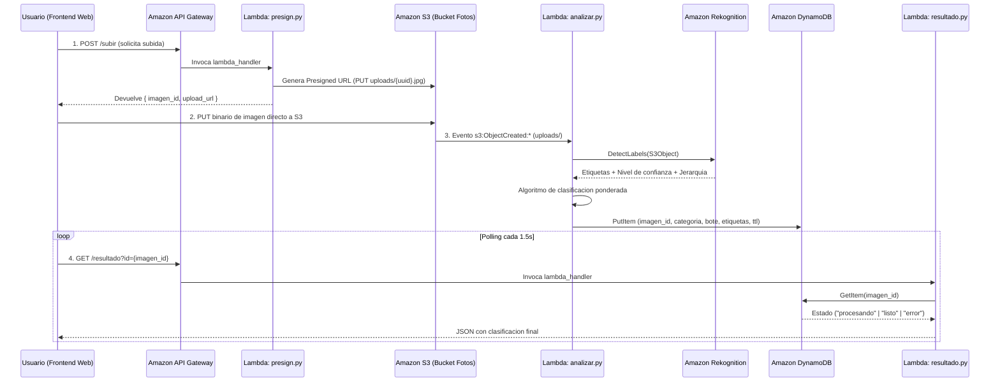

# Clasificador Inteligente de Residuos en AWS

Aplicacion web serverless construida sobre servicios administrados de Amazon Web Services (AWS) que permite fotografiar o subir imagenes de residuos para clasificarlos automaticamente en tres categorias de separacion:

- **Bote ORGANICO (verde)**
- **Bote INORGANICO RECICLABLE (azul)**
- **Bote INORGANICO NO RECICLABLE (gris)**

El analisis de vision artificial se realiza mediante **Amazon Rekognition** (`DetectLabels`), procesando jerarquias de etiquetas y reglas ponderadas para evitar falsos positivos entre materiales genericos (como plastico o papel) y objetos especificos no reciclables (como bolsas plasticas, popotes o servilletas).

---

## Arquitectura y Flujo de Trabajo



---

## Estructura del Proyecto

```text
.
├── .env.example                 # Plantilla de variables de entorno (region, bucket, tabla, CORS, api)
├── frontend/
│   └── index.html               # Interfaz web (HTML5, CSS3, JS Vanilla + compresion en cliente)
├── lambdas/
│   ├── presign.py               # Lambda #1: Genera URL prefirmada de S3 (POST /subir)
│   ├── analizar.py              # Lambda #2: Trigger S3 -> Rekognition -> DynamoDB
│   └── resultado.py             # Lambda #3: Consulta resultado en DynamoDB (GET /resultado)
├── template.yaml                # Plantilla de infraestructura AWS SAM (CloudFormation)
├── despliegue-consola.md        # Guia paso a paso desde la consola de AWS (sin CloudFront)
├── despliegue-cloudfront.md     # Guia paso a paso con Amazon CloudFront y OAC (HTTPS)
└── README.md                    # Documentacion general del proyecto
```

---

## Descripcion de los Componentes

### 1. Frontend (`frontend/index.html`)
Aplicacion de pagina unica (SPA) sin dependencias externas ni paso de compilacion:
- Soporta captura directa desde camara en dispositivos moviles o arrastrar y soltar archivos (Drag & Drop).
- Redimensiona y comprime la fotografia en el navegador (Canvas a JPEG) antes de enviarla a S3 para reducir el consumo de datos y acelerar la respuesta.
- Sube el archivo directamente a Amazon S3 usando la URL prefirmada, evitando el limite de payload de API Gateway y Lambda.
- Realiza consultas periodicas (*polling*) al endpoint `/resultado` hasta obtener el dictamen.
- Maneja estados visuales dedicados para las tres categorias de residuos, asi como la tarjeta ambar de **"No identificado"** cuando la foto no contenga un residuo reconocible.

### 2. Funciones AWS Lambda (`lambdas/`)
Cada funcion esta separada en un archivo independiente y autocontenido con punto de entrada estandar `lambda_handler(event, context)`:

| Archivo | Endpoint / Evento | Rol / Accion principal | Variables de Entorno | Timeout recomendado |
|---|---|---|---|---|
| `lambdas/presign.py` | `POST /subir` (API Gateway) | Valida el tipo MIME (`image/jpeg`, `image/png`) y firma una URL temporal de 5 minutos para `s3:PutObject` en `uploads/{uuid}.{ext}` con CORS parametrizable. | `BUCKET`, `ALLOWED_ORIGIN` | 15 seg |
| `lambdas/analizar.py` | `s3:ObjectCreated:*` en `uploads/` | Invoca `rekognition.detect_labels`, ejecuta el algoritmo de ponderacion de residuos y guarda el resultado en DynamoDB con expiracion TTL de 24 horas. | `BUCKET`, `TABLE` | 30 seg |
| `lambdas/resultado.py` | `GET /resultado?id={id}` (API Gateway) | Consulta la clave primaria `imagen_id` en DynamoDB y retorna el estado (`procesando`, `listo` o `error`) junto con el bote sugerido y etiquetas con CORS parametrizable. | `TABLE`, `ALLOWED_ORIGIN` | 15 seg |

### 3. Logica de Clasificacion Refinada (`lambdas/analizar.py`)
El clasificador pondera las etiquetas devueltas por Amazon Rekognition aplicando filtros estrictos contra falsos positivos:
1. **Prioridad a objetos especificos no reciclables (`NO_RECICLABLE`):** Si Rekognition detecta un objeto como `Plastic Bag`, `Straw`, `Napkin` o `Styrofoam`, le otorga mayor peso (`x1.8`) para asegurar su correcta clasificacion en el bote gris.
2. **Objetos reciclables especificos (`RECICLABLE`):** Botellas (`Bottle`, `Plastic Bottle`, `Glass Bottle`), latas (`Can`, `Aluminum Can`), carton y cajas limpias (`Cardboard`, `Carton`, `Box`), frascos (`Jar`, `Mason Jar`).
3. **Materiales genericos (`MATERIALES_GENERICOS`):** Las etiquetas genericas (`Plastic`, `Paper`, `Metal`, `Foil`, `Container`, `Glass`, `Steel`) **no** clasifican como reciclable por si solas. Solo aportan un puntaje complementario leve (`0.3`) si y solo si se identifico previamente un objeto reciclable especifico (por ejemplo, `Plastic Bottle`), evitando que un plastico sucio o desechable no reconocido se marque erroneamente como reciclable.
4. **Residuos organicos (`ORGANICO`):** Frutas, verduras, restos de comida, plantas y hojas (`Fruit`, `Vegetable`, `Food`, `Plant`, `Bread`, etc.).
5. **Manejo de imagenes no reconocidas (`no_identificado`):** Si la imagen no contiene etiquetas que coincidan con residuos (o la suma ponderada es 0), el sistema ya no fuerza un falso `no_reciclable` con confianza 0%, sino que devuelve la categoria `no_identificado`, solicitando al usuario acercar o iluminar mejor el objeto.

### 4. Base de Datos y Almacenamiento
- **Amazon DynamoDB:** Tabla configurada en modo **Aprovisionado (5 RCU y 5 WCU)** para aprovechar el nivel **Always Free** de AWS (que otorga hasta 25 RCU, 25 WCU y 25 GB de almacenamiento gratis de forma permanente), con clave de particion `imagen_id` (`String`) y limpieza automatica mediante el atributo TTL `ttl` (24 horas).
- **Amazon S3 (Bucket de imagenes):** Bucket privado con configuracion CORS para permitir `PUT` desde el navegador y regla de ciclo de vida para eliminar objetos en `uploads/` despues de 1 dia.

---

## Compatibilidad con AWS Free Tier (Cuentas Nuevas)

Este proyecto es **100% realizable sin costo** con la capa gratuita de AWS.

Desde el **15 de julio de 2025**, AWS actualizo su programa Free Tier para cuentas nuevas combinando servicios **Always Free (Siempre Gratis)** con un paquete de **hasta $200 USD en creditos por 6 meses** ($100 USD al crear la cuenta + hasta $100 USD al completar actividades basicas como crear una Lambda o configurar un presupuesto en AWS Budgets), disponible tanto en el **Free Plan** (que bloquea cualquier cargo a tu tarjeta) como en el **Paid Plan**:

| Servicio en el Proyecto | Categoria Free Tier | Limite Gratuito / Cobertura | Consumo del Proyecto |
|---|---|---|---|
| **AWS Lambda** | Always Free (Permanente) | 1,000,000 de invocaciones y 400,000 GB-seg al mes | $0.00 USD |
| **Amazon DynamoDB** | Always Free (Permanente) | 25 GB + 25 RCU y 25 WCU en modo **Provisioned** | $0.00 USD (usando 5 RCU / 5 WCU) |
| **Amazon CloudFront** | Always Free (Permanente) | 1 TB de transferencia y 10,000,000 de peticiones al mes | $0.00 USD |
| **Amazon CloudWatch** | Always Free (Permanente) | 5 GB de logs y metricas basicas al mes | $0.00 USD |
| **Amazon Rekognition** | Creditos Free Tier / 12m Legacy | 1,000 imagenes/mes gratis (Legacy) o $0.001 USD por foto (`DetectLabels` Grupo 2) cubierto por los $100-$200 USD de credito | 1,000 fotos = $1.00 USD en creditos ($0 de tu bolsillo) |
| **Amazon S3** | Creditos Free Tier / 12m Legacy | 5 GB, 20,000 GET y 2,000 PUT gratis (Legacy) o cubierto por creditos ($0.005 USD cada 1,000 subidas) | Menos de $0.01 USD en creditos |
| **Amazon API Gateway** | Creditos Free Tier / 12m Legacy | 1,000,000 de llamadas REST/mes (Legacy) o cubierto por creditos ($0.0035 USD cada 1,000 llamadas) | Menos de $0.01 USD en creditos |

> **Nota importante de ahorro aplicada en el proyecto:**
> 1. En **DynamoDB**, se utiliza el modo **Aprovisionado (5 RCU / 5 WCU)** en lugar de *On-Demand*, ya que AWS solo aplica la capa gratuita permanente (*Always Free*) a capacidad aprovisionada menor o igual a 25 unidades.
> 2. En **Rekognition** (`lambdas/analizar.py`), se invoca `detect_labels` **sin** activar `IMAGE_PROPERTIES`, dado que `IMAGE_PROPERTIES` se factura por separado fuera de la tarifa base.

---

## Opciones de Despliegue

El proyecto cuenta con tres metodos de despliegue documentados:

### Opcion A: Desde la Consola de AWS (Sin CloudFront)
Ideal para laboratorios, pruebas rapidas y aprendizaje directo en la interfaz web de AWS alojando el frontend en S3 Static Website Hosting.
- Consulta la guia detallada en: [despliegue-consola.md](./despliegue-consola.md)

### Opcion B: Desde la Consola de AWS con Amazon CloudFront (HTTPS + OAC)
Ideal para entornos productivos donde el bucket del frontend se mantiene 100% privado mediante Origin Access Control (OAC) y se sirve bajo HTTPS con baja latencia.
- Consulta la guia detallada en: [despliegue-cloudfront.md](./despliegue-cloudfront.md)

### Opcion C: Despliegue Automatizado con AWS SAM CLI
Si dispones de AWS CLI y AWS SAM CLI configurados en tu terminal, puedes desplegar todo el backend con `template.yaml`:

```bash
sam build
sam deploy --guided
```

Al finalizar el despliegue con SAM, la terminal mostrara en los `Outputs` el valor de `ApiUrl`, el cual puedes colocar directamente en la interfaz web `frontend/index.html`.
# Residue_Classifier
